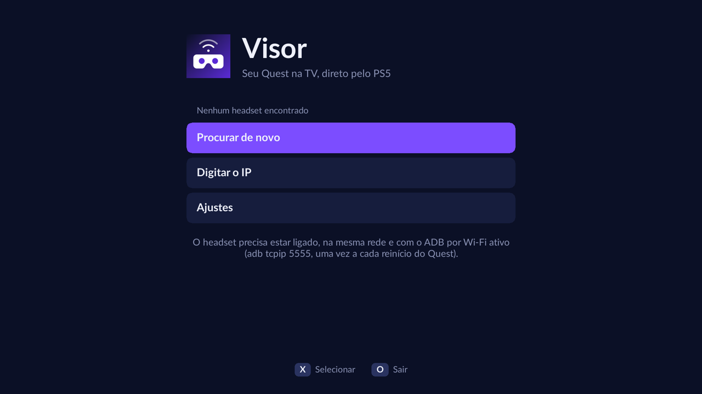

<p align="center"></p>
<h1 align="center">Visor</h1>
<p align="center">Watch your Meta Quest 2 on the TV, straight from a jailbroken PS5.<br/>
<a href="README.pt-BR.md">Português</a></p>



Visor is a PS5 homebrew that mirrors a Quest 2 headset to the TV. The PS5 talks
to the headset directly over Wi-Fi: no PC in the middle and nothing to install
on the Quest.

- Finds headsets on the network by itself
- One eye, cropped to 16:9, instead of the raw double image
- Quality presets (resolution, bitrate, frame rate) or manual values, H.264 or H.265
- Live reframing with the D-pad while watching
- Home screen shortcut on the PS5
- English and Portuguese

## Requirements

- A jailbroken PS5 with an ELF loader listening on port 9021 (every current
  jailbreak has one). Nothing else: no websrv, no Homebrew Launcher.
- A Quest 2 in developer mode with ADB over Wi-Fi turned on. This needs a USB
  cable and a computer once per headset reboot:

  ```
  adb tcpip 5555
  ```

- PS5 and headset on the same network.

## Install

1. Download `visor.elf` from the [releases](../../releases).
2. Send it to the PS5 like any other payload, for example:

   ```
   socat -t 99999999 - TCP:<ps5-ip>:9021 < visor.elf
   ```

3. A notification says Visor is ready and a **Visor** icon shows up on the
   home screen. Open it from there.

`visor.elf` is a single file: it unpacks itself to `/data/visor`, adds the
icon and stays in the background to open the app when the icon is pressed.
Like every payload it is gone after a console restart, so send it again after
jailbreaking (or add it to your loader's autoload list). The icon and your
settings stay.

The first time you connect, put the headset on: it asks whether to allow USB
debugging. Tick "Always allow".

## Controls

| Screen | Button | Action |
| --- | --- | --- |
| Menus | D-pad / Cross / Circle | Move / select / back |
| Watching | Options | Show or hide stats and hints |
| Watching | D-pad | Reframe the picture |
| Watching | L1 / R1 | Zoom out / in |
| Watching | Circle | Stop |

Reframing restarts the stream (about a second), because the crop happens on
the headset.

## Limits

- **No audio.** Capturing it would mute the headset for whoever is wearing it.
- **Quest 2 only for now.** Other headsets have different screens, so the eye
  crop would be off. "Both eyes" in the settings works on anything.
- The headset has to be awake (on your head) to stream.
- The home screen icon is a web shortcut, so the console opens its browser
  window first and leaves it in front of Visor. Press Circle once to dismiss it.

## How it works

Visor carries a small ADB client. It connects to the headset on port 5555,
pushes the [scrcpy](https://github.com/Genymobile/scrcpy) server, starts it
with the chosen crop and quality, and decodes the video stream with FFmpeg into
an SDL2 texture. The UI is RmlUi.

The app is launched as a regular PS5 application by the homebrew loader from
[websrv](https://github.com/ps5-payload-dev/websrv), built into `visor.elf`.

## Building

On Ubuntu 24.04 (WSL works), `sudo bash tools/setup-wsl.sh` installs the
compilers and the [ps5-payload-dev](https://github.com/ps5-payload-dev/pacbrew-repo)
toolchain. Then:

```
bash tools/build-ps5.sh                          # dist/visor.elf
bash tools/send-elf.sh <ps5-ip> dist/visor.elf   # send it to the console
```

The log of the last run is `/data/visor/visor.log` on the console.
`curl http://<ps5-ip>:8744/` opens the app without touching the controller.

```
```

There is also a PC build for working without the console:

```
bash tools/run-coretest.sh <quest-ip>     # ADB + stream + decode, saves a frame
bash tools/uishot.sh out.bmp "down ok"    # renders a screen headlessly
```

## License

GPL-3.0. Third-party parts are listed in [NOTICE.md](NOTICE.md).
